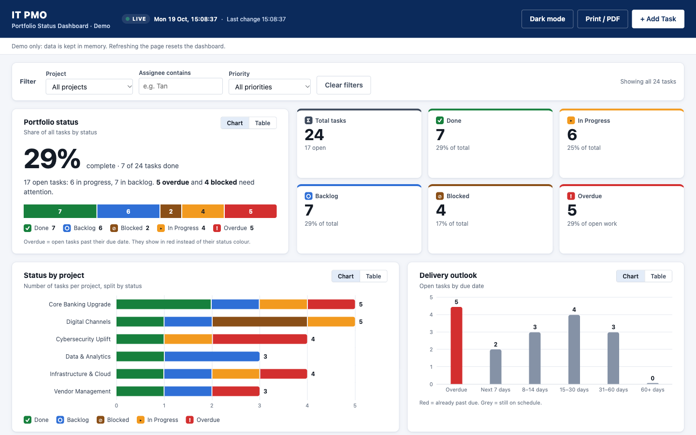

# IT PMO Status Dashboard (v2)

A demo IT PMO portfolio status dashboard and Kanban board for a **fictitious** bank. It is a single-file, dependency-free web app that shows senior management where delivery stands at a glance.

[](https://developer.mozilla.org/docs/Web/HTML)
[](https://developer.mozilla.org/docs/Web/CSS)
[](https://developer.mozilla.org/docs/Web/JavaScript)
[](#tech-stack)
[](https://karth510.github.io/Claude-Training-v2/)
[](https://github.com/karth510/Claude-Training-v2/actions/workflows/pages.yml)
[](https://karth510.github.io/Claude-Training-v2/)

## Live demo

**<https://karth510.github.io/Claude-Training-v2/>**

The original Kanban-only version (v1) is still live at <https://karth510.github.io/Claude-Training/>.

## Screenshot



## Features

### Status colours

Every panel uses the same colours, and each status also has an icon so colour is never the only cue:

| Status | Colour | Icon |
|---|---|---|
| Overdue | Red | ! |
| Done | Green | ✓ |
| Backlog | Blue | ○ |
| In Progress | Orange | ▸ |
| Blocked | Brown | ⊘ |

The chart order (Done → Backlog → Blocked → In Progress → Overdue) was checked for colour-blind safety, so red never sits next to green or brown. Dark mode has its own tuned colours.

### Dashboard

- **Live header:** a LIVE indicator, a ticking clock and the time of the last change. Overdue flags recalculate at midnight if the page is left open.
- **Executive summary:** a large % complete figure, a one-sentence status summary and a 100% status bar with a legend.
- **KPI tiles:** total, Done, In Progress, Backlog, Blocked and Overdue, each with its share.
- **Status by project:** stacked bars per project on a shared count axis.
- **Delivery outlook:** open tasks by due-date window (overdue, next 7 days, 8–14, 15–30, 31–60, 60+).
- **Needs attention:** overdue and blocked tasks, most late first, with owner, priority and days late. Each task ID jumps to its card on the board.
- Every chart has a **Chart / Table** toggle and hover/focus tooltips.
- **Filters** by project, assignee and priority apply to the whole dashboard.
- **Dark mode** toggle and **Print / PDF** for board packs.

### Kanban board (K-Graph)

- Four columns (Backlog, In Progress, Blocked, Done), each topped in its status colour with a live count.
- **Drag and drop** cards between columns, or use the keyboard-friendly "Move" menu.
- **Add tasks** with inline validation. **Delete** uses an inline "Delete? Yes / No" confirmation, with no browser pop-ups.
- **Email notification** for each new task via [FormSubmit](https://formsubmit.co/) (subject `[IT PMO] …`). The card appears immediately. If the email fails, you only get a warning toast.
- **No persistence on purpose:** data lives in memory, so a refresh resets everything to the 24 seed tasks. Seed due dates are relative to today, so the demo always has overdue and upcoming work.

## Tech stack

- Vanilla HTML, CSS and JavaScript, all in one `index.html`.
- No frameworks, chart libraries, build step, npm, CDN scripts, web fonts or images. Charts are plain HTML/CSS. It uses the system font stack and Unicode icons.
- Colours and spacing come from CSS custom properties on `:root`.

## How to install

```bash
git clone https://github.com/karth510/Claude-Training-v2.git
cd Claude-Training-v2
```

There is nothing else to install.

## How to run

- **Quickest:** double-click `index.html`. It works from `file://`.
- **With working email notifications:** FormSubmit may reject `file://` origins, so serve the folder locally:

  ```bash
  python3 -m http.server 8000
  # then open http://localhost:8000
  ```

### Configure the notification email

1. In `index.html`, set the address in `FORMSUBMIT_ENDPOINT` (near the top of the `<script>` block):

   ```js
   const FORMSUBMIT_ENDPOINT = "https://formsubmit.co/ajax/you@example.com";
   ```

2. Add a task once. FormSubmit sends a one-time **activation email** to that address. Click the link in it, and notifications are delivered from then on.

> The address in `FORMSUBMIT_ENDPOINT` is visible to anyone viewing the published page. The repo ships with the placeholder `YOUR_EMAIL@example.com`.

## CI/CD

[`.github/workflows/pages.yml`](.github/workflows/pages.yml) runs on every push to `main`, on pull requests and on demand:

- **`check` job** (pushes and PRs):
  - Fails on forbidden APIs: `localStorage`, `sessionStorage`, IndexedDB, cookies, `alert`/`confirm`, `!important`, or any URL other than the FormSubmit endpoint.
  - Fails on extra network calls: anything besides the single FormSubmit `fetch`, such as external scripts, stylesheets or images.
  - Syntax-checks the inline script with `node --check`.
  - Greps tracked files for common secret patterns.
- **`deploy` job** (push to `main` only, after `check` passes): stages **only** `index.html` and deploys it to GitHub Pages. Repo docs such as `CLAUDE.md` are never published.

## Project structure

```
.
├── index.html                    # The whole app: markup, <style> and <script>
├── README.md
├── CLAUDE.md                     # Constraints and architecture notes for contributors / AI assistants
├── docs/screenshot.png           # README screenshot (captured with Playwright MCP; not deployed)
├── .gitignore
└── .github/workflows/pages.yml   # CI checks + GitHub Pages deploy
```

## Privacy and security

- No `localStorage`, `sessionStorage`, IndexedDB or cookies. Nothing is stored in the browser.
- No analytics, tracking, external scripts or fonts.
- The **only** outbound request is the FormSubmit AJAX call made when you add a task. It sends that task's details to the configured address.
- Every user-supplied string is HTML-escaped before rendering.

## Disclaimer

This is a training/demo project. The bank, projects, people and tasks are all fictitious. It is not affiliated with, endorsed by, or representative of any real bank or financial institution.
